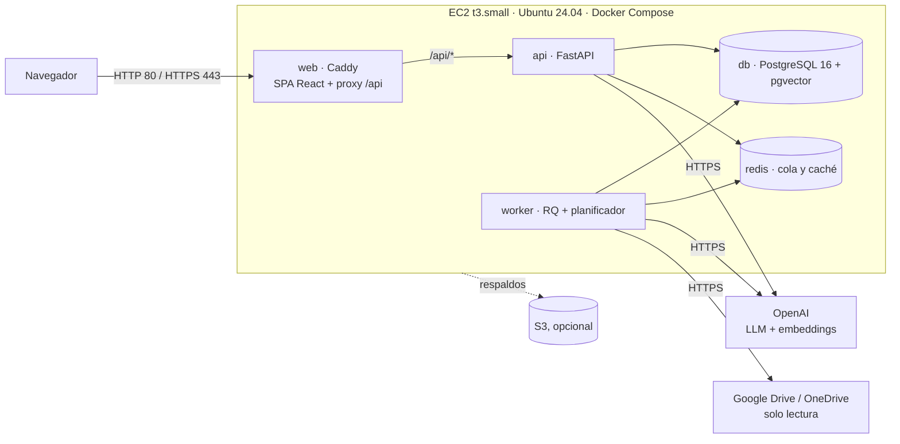

# Despliegue en AWS

Guía para dejar BeeMatch en línea con la cuenta estudiantil de AWS (50 USD de crédito). Todo lo descrito aquí se probó localmente con `docker-compose.prod.yml` (construcción, arranque, login por el proxy, respaldo y restauración, caída de Redis). **Lo que no se pudo probar sin una cuenta de AWS** está marcado como tal.

## Arquitectura elegida

Una sola instancia EC2 con Docker Compose. Es la opción que cabe en el crédito y la que menos piezas tiene para un sistema con menos de 10 usuarios concurrentes (Sprint 0, sección 6.1).



Solo `web` publica puertos (80 y 443). La base de datos, Redis y la API quedan en la red interna de Docker.

### Por qué no RDS / ElastiCache / ECS

| Opción | Costo mensual aprox. | Veredicto |
|---|---|---|
| RDS PostgreSQL `db.t4g.micro` | ~13 USD + almacenamiento | Es la mejor práctica para producción real (respaldos y parches gestionados) y admite pgvector. Con 50 USD de crédito consume un tercio solo en la base. |
| ElastiCache | ~12 USD el nodo más pequeño | Para una cola que mueve decenas de trabajos al día no se justifica. |
| ECS/Fargate + ALB | ALB ~16 USD fijos + tareas | Más piezas y más costo sin beneficio a esta escala. |
| **Una EC2 con Compose** | **~21 USD** | Elegida. El costo es predecible y todo cabe en una máquina. |

El camino de salida existe: la base se respalda con `pg_dump` y la API solo necesita una `DATABASE_URL`, así que moverse a RDS más adelante es cambiar esa variable y restaurar un respaldo.

## Costo estimado

Precios de lista en us-east-1 (por hora × 730 h al mes). El de las instancias se verificó contra tablas públicas ([t3.small](https://calculator.holori.com/aws/ec2/t3.small/us-east-1), [t3.medium](https://calculator.holori.com/aws/ec2/t3.medium/us-east-1)); la IPv4 pública y el disco gp3 son los de la lista de AWS: **confirma los valores vigentes en la [calculadora de AWS](https://calculator.aws/) antes de depender del cálculo.**

| Concepto | t3.small (2 GB) | t3.medium (4 GB) |
|---|---|---|
| Instancia (0,0208 / 0,0416 USD por hora) | 15,18 | 30,37 |
| Disco gp3 de 30 GB (0,08 USD/GB) | 2,40 | 2,40 |
| IPv4 pública (0,005 USD por hora) | 3,65 | 3,65 |
| Tráfico de salida (unos pocos GB) | ~0 | ~0 |
| **Total mensual** | **~21** | **~36** |
| **Duración del crédito de 50 USD** | **~2,3 meses** | **~1,4 meses** |

OpenAI se paga aparte: según la medición del Sprint 2, 100 búsquedas cuestan unos 1.065 COP. La indexación inicial de ~200 hojas de vida es el gasto más grande de embeddings, y ocurre una sola vez.

**Para estirar el crédito:** detener la instancia cuando no se use (en la consola: *Detener*, no *Terminar*). Mientras está detenida solo se cobra el disco y la IP elástica (~6 USD al mes). Al volver a iniciarla, `restart: unless-stopped` levanta todo solo.

**Recomendación:** empezar con `t3.small` y 2 GB de swap (lo crea el script de arranque). Si la construcción de las imágenes se queda sin memoria o la API se pone lenta, pasar a `t3.medium` (se cambia el tipo de instancia con la máquina detenida, sin perder datos).

> Si la cuenta es de **AWS Academy / Learner Lab** en lugar de una cuenta normal con créditos: no se pueden crear roles IAM propios (se usa el `LabRole` ya existente) y algunos servicios están bloqueados, pero EC2, EBS, grupos de seguridad e IP elástica funcionan, y esta guía solo usa esos. La IP pública cambia cada vez que se detiene la instancia salvo que se use una IP elástica (paso 1).

## Antes de empezar (checklist)

- [ ] Clave de OpenAI (la del LLM y la de embeddings; pueden ser la misma).
- [ ] Credenciales del repositorio de hojas de vida (cuenta de servicio de Google Drive o aplicación de Microsoft Graph). Se pueden registrar después, desde la aplicación.
- [ ] Acceso al repositorio de GitHub desde el servidor (si es privado: un token de acceso personal de solo lectura o una *deploy key*).
- [ ] Opcional pero recomendado: un dominio o subdominio gratuito (por ejemplo, de [DuckDNS](https://www.duckdns.org/)) para tener HTTPS.

## Paso a paso

### 1. Crear la instancia

En la consola de EC2, *Lanzar instancia*:

| Campo | Valor |
|---|---|
| AMI | Ubuntu Server 24.04 LTS |
| Tipo | `t3.small` |
| Par de claves | Crear uno nuevo y guardar el `.pem` |
| Almacenamiento | 30 GB, gp3 |
| Grupo de seguridad | Entrada: **22** (SSH) solo desde *Mi IP*; **80** y **443** desde cualquier lugar |

No abras 5432, 6379 ni 8000: no hace falta y la base quedaría expuesta.

Después, en *IP elásticas*: asignar una y asociarla a la instancia. Así la dirección no cambia al detenerla.

### 2. Preparar el servidor (una sola vez)

```bash
ssh -i clave.pem ubuntu@<IP-elástica>
```

Copia el script al servidor y ejecútalo (si el repositorio es público, se puede descargar directamente):

```bash
# desde tu máquina
scp -i clave.pem scripts/aws/bootstrap-ec2.sh ubuntu@<IP-elástica>:~
# en el servidor
sudo bash bootstrap-ec2.sh
```

Instala Docker, crea 2 GB de swap y activa las actualizaciones de seguridad. **Cierra la sesión SSH y vuelve a entrar** para que tome efecto el grupo `docker`.

### 3. Traer el código

```bash
cd /opt/beematch
git clone https://github.com/jalvarez01/BeeMatch.git app    # repo privado: usar el token como contraseña
cd app
git checkout development                                      # o main, según lo que se despliegue
```

### 4. Configurar los secretos

```bash
cp .env.production.example .env.production
chmod 600 .env.production
```

Genera los valores y pégalos en el archivo:

```bash
openssl rand -base64 24 | tr -d '/+='                 # POSTGRES_PASSWORD
openssl rand -hex 32                                  # JWT_SECRET
docker run --rm python:3.12-slim sh -c "pip -q install cryptography && python -c 'from cryptography.fernet import Fernet; print(Fernet.generate_key().decode())'"   # ENCRYPTION_KEY
```

Y completa a mano: `SUPERUSUARIO_CORREO`, `SUPERUSUARIO_PASSWORD` (mínimo 12 caracteres), `LLM_API_KEY`, `EMBEDDING_API_KEY`.

> **Guarda `ENCRYPTION_KEY` y `JWT_SECRET` también fuera del servidor** (un gestor de contraseñas). `ENCRYPTION_KEY` cifra las credenciales del repositorio en la base: si se pierde, hay que volver a registrarlas.

Para probar con la IP, deja `SITIO=:80`. Para HTTPS, ver el paso 7.

La API **se niega a arrancar** con `ENTORNO=produccion` si `JWT_SECRET` es el de ejemplo o es corto, si `ENCRYPTION_KEY` falta o no es válida, si la base no es PostgreSQL o si la clave de la superusuaria es débil, y dice cuál es el problema en `docker compose logs api`.

### 5. Desplegar

```bash
./scripts/aws/desplegar.sh
```

Construye las imágenes (unos 3 a 6 minutos la primera vez en una `t3.small`), levanta todo, espera a que la API esté sana y muestra el estado. Lo mismo sirve para actualizar más adelante: trae los cambios (`git pull`), hace un respaldo previo de la base y reconstruye.

### 6. Verificar

```bash
curl http://<IP-elástica>/api/health/ready
# {"status":"ok","base_de_datos":"ok","redis":"con worker"}
```

Y en el navegador, `http://<IP-elástica>`:

- [ ] Carga la pantalla de inicio de sesión.
- [ ] Entra con la superusuaria (`SUPERUSUARIO_CORREO` / `SUPERUSUARIO_PASSWORD`).
- [ ] *Configuración*: registrar el repositorio de hojas de vida y probar la conexión.
- [ ] Lanzar la sincronización y esperar a que las hojas de vida pasen a *Indexada*.
- [ ] Crear una solicitud y ejecutar una búsqueda: el indicador de progreso avanza y llega al Top 5.
- [ ] Exportar la preselección en PDF y en Excel.

### 7. Dominio y HTTPS (recomendado)

Sin HTTPS, la contraseña y el token de sesión viajan sin cifrar. Para activarlo:

1. Crear un subdominio (por ejemplo `beematch.duckdns.org`) apuntando a la IP elástica.
2. En `.env.production`:
   ```
   SITIO=beematch.duckdns.org
   ALLOWED_ORIGINS=https://beematch.duckdns.org
   ```
3. `./scripts/aws/desplegar.sh`. Caddy pide el certificado a Let's Encrypt la primera vez (necesita los puertos 80 y 443 abiertos y que el DNS ya apunte al servidor).

### 8. Llevar los datos de desarrollo al servidor (opcional)

Solo si la base local tiene datos que quieres conservar. Si no, salta este paso: se vuelve a sincronizar desde el repositorio.

```bash
# desde tu máquina
scp -i clave.pem data/beematch.db ubuntu@<IP>:/tmp/origen.db
# en el servidor
cd /opt/beematch/app
DC="docker compose -f docker-compose.prod.yml --env-file .env.production"
$DC stop api worker
$DC run --rm --no-deps -v /tmp/origen.db:/tmp/origen.db:ro api sh -c \
  'python -m scripts.migrar_sqlite_a_postgres --origen /tmp/origen.db --destino "$DATABASE_URL" --vaciar'
$DC start api worker
```

Detalles y precauciones en [`base-de-datos.md`](base-de-datos.md). Las credenciales del repositorio de la base local no se podrán descifrar con la clave del servidor: hay que volver a registrarlas desde *Configuración*. Después **borra** `/tmp/origen.db` del servidor.

## Operación

| Tarea | Comando |
|---|---|
| Estado | `docker compose -f docker-compose.prod.yml --env-file .env.production ps` |
| Logs de la API | `docker compose -f docker-compose.prod.yml --env-file .env.production logs -f api` |
| Logs del worker | `... logs -f worker` |
| Actualizar a la última versión | `./scripts/aws/desplegar.sh` |
| Respaldo manual | `./scripts/aws/respaldar.sh` (deja el `.dump` en `respaldos/`, conserva los 7 últimos) |
| Restaurar | `./scripts/aws/restaurar.sh respaldos/beematch-AAAAMMDD-HHMMSS.dump` |
| Reiniciar un servicio | `... restart api` |

Respaldo diario a las 2:00 (hora del servidor, UTC):

```bash
(crontab -l 2>/dev/null; echo "0 2 * * * /opt/beematch/app/scripts/aws/respaldar.sh >> /opt/beematch/respaldos/cron.log 2>&1") | crontab -
```

Los respaldos quedan **en el mismo disco**: protegen de un error de la aplicación, no de perder la instancia. Para eso, `BUCKET_RESPALDOS=<bucket>` en el entorno del cron sube cada uno a S3 (la instancia necesita un rol con permiso de escritura en ese bucket; en Learner Lab, el `LabRole` ya suele tenerlo). Como alternativa mínima, descarga uno con `scp` antes de las presentaciones.

### Actualizar con confianza

1. `./scripts/aws/desplegar.sh` ya hace un respaldo previo.
2. Si algo sale mal: `git checkout <commit-anterior>`, `SIN_GIT=1 ./scripts/aws/desplegar.sh`; y si el problema fue de datos, `restaurar.sh` con el respaldo previo.

## Observabilidad

- **Logs en JSON** (una línea por evento) en producción; legibles en desarrollo. Se fuerza con `LOG_FORMATO=json|texto`, el nivel con `LOG_NIVEL`.
- **Identificador de petición:** cada respuesta trae `X-Request-ID` y todos los logs de esa petición lo llevan. Si un usuario reporta un error, con ese id se encuentra el evento:
  ```bash
  docker compose -f docker-compose.prod.yml --env-file .env.production logs api | grep 3f9c2a1b7e44
  docker compose ... logs api | jq 'select(.estado >= 500)'
  ```
- Se registra método, ruta, estado y duración. **Nunca** el cuerpo ni la query string (ahí viajan contraseñas y tokens). Los llamados salientes de `httpx` (Drive, Graph, OpenAI) se silencian por la misma razón.
- `/health` y `/health/ready` no se registran, para que el healthcheck no llene el log.
- **Sentry (opcional):** con `SENTRY_DSN` en `.env.production` se envían las excepciones no controladas, sin datos personales (`send_default_pii=False`). Sin DSN no hace nada.

## Secretos

Los secretos viven en `.env.production` (permisos `600`). Para no perderlos si se pierde la instancia y poder recrearla, `scripts/aws/secretos-ssm.sh` los guarda en **AWS Systems Manager Parameter Store** como `SecureString` (cifrados con KMS; el nivel estándar no cuesta):

```bash
./scripts/aws/secretos-ssm.sh subir    # .env.production -> /beematch/prod/*   (desde tu máquina o la instancia)
SOBRESCRIBIR=1 ./scripts/aws/secretos-ssm.sh bajar    # en un servidor nuevo: recrea .env.production
```

Necesita la CLI de AWS y permisos `ssm:PutParameter`, `ssm:GetParametersByPath` y `kms:Decrypt`. Probado con una `aws` simulada (omite comentarios y vacíos, conserva valores con `=` y espacios, deja el archivo en `600`, no pisa uno existente); **no se probó contra AWS real**, y en Learner Lab Systems Manager puede estar restringido. Si lo está, guarda los valores en un gestor de contraseñas. Nota: `put-parameter` recibe el valor como argumento, visible un instante en la lista de procesos del mismo equipo.

## Seguridad: lo que ya está y lo que falta

Ya está:
- Solo 80 y 443 públicos; base, Redis y API en red interna.
- La API corre sin privilegios de root y se niega a arrancar con configuración de ejemplo.
- Secretos en `.env.production` con permisos `600`, fuera del repositorio.
- Credenciales del repositorio de hojas de vida cifradas en base de datos.
- Cabeceras `X-Content-Type-Options`, `X-Frame-Options` y `Referrer-Policy`.
- Bloqueo de cuenta tras 5 intentos fallidos (HU-01) y sesión de 30 minutos (HU-02).

Falta o conviene revisar:
- **HTTPS** exige un dominio (paso 7).
- SSH abierto solo a tu IP: si cambia, actualiza el grupo de seguridad.
- No hay inicio de sesión corporativo (Entra ID): ver [`pendientes-de-arquitectura.md`](pendientes-de-arquitectura.md).
- Los respaldos fuera de la instancia son opcionales y requieren configurar el bucket.

## Lo que NO se pudo probar sin AWS

- La creación de la instancia, el grupo de seguridad y la IP elástica (son pasos de consola).
- `bootstrap-ec2.sh` en una Ubuntu real (se revisó la sintaxis y se siguió la documentación oficial de Docker, pero no se ejecutó en una máquina nueva).
- La emisión del certificado HTTPS con un dominio real.
- El rendimiento en una `t3.small`: las pruebas fueron en un portátil. Si la construcción o la API se quedan sin memoria, pasar a `t3.medium`.
- Una búsqueda completa con OpenAI y el repositorio real dentro del contenedor (sin credenciales en el entorno de prueba).
